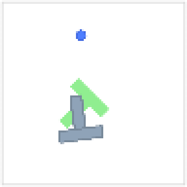
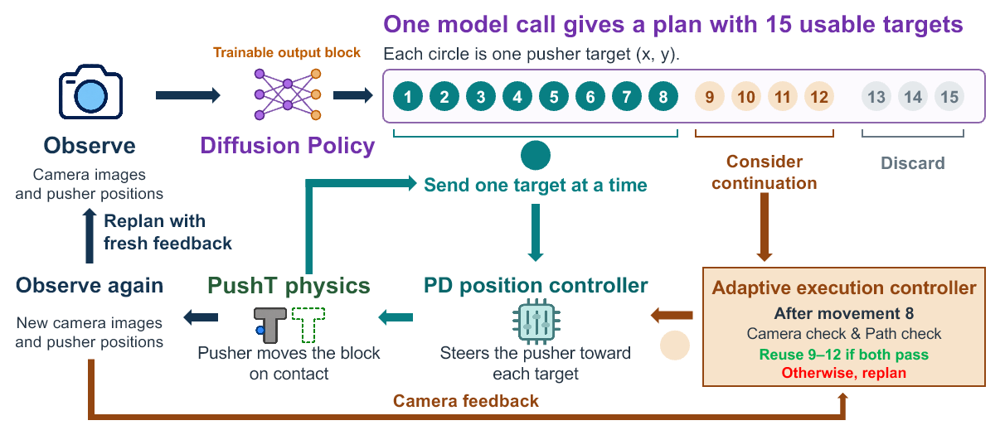
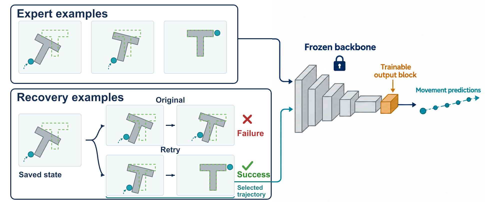

# Adaptive Execution and Self-Imitation-Based Fine-Tuning for Robotic Pushing

This project asks whether a robot can complete more PushT attempts while calling its pretrained Diffusion Policy less often. It combines adaptive execution with fine-tuning on successful retries of failed pushes.

## Table of contents

- [Task and feedback loop](#task-and-feedback-loop)
- [Methods](#methods)
  - [Workflow](#workflow)
  - [Adaptive execution controller](#adaptive-execution-controller)
  - [Recovery fine-tuning](#recovery-fine-tuning)
- [Evaluation and results](#evaluation-and-results)
  - [What the comparison shows](#what-the-comparison-shows)
- [Getting started](#getting-started)
- [Repository structure](#repository-structure)
- [References and reused components](#references-and-reused-components)

## Task and feedback loop

In **PushT**, a simulated pusher moves a T-shaped block onto the green target. The feedback loop has three steps.

1. **Observe.** Read the camera images and pusher positions.
2. **Predict.** Use Diffusion Policy to generate a sequence of pusher targets.
3. **Execute.** Send each target to PushT's PD position controller. Each movement changes the scene and produces updated observations for the next plan.



*Recorded PushT attempt from scene seed 0.*

## Methods

### Workflow

One model call generates 16 positions internally. Aligning them with the latest observation leaves **15 usable pusher targets**, each an `(x, y)` position. The fixed-eight baseline sends targets **1–8** to the PD position controller one at a time, then requests a fresh plan.

Our controller makes **one extension decision after movement 8**. If both the camera and path checks pass, it sends targets **9–12** from the same plan to the PD controller. Otherwise, it replans from fresh observations. Targets 13–15 go unused. The controller also monitors camera feedback after each movement. A separate early-interruption rule can discard pending targets and replan after a confirmed drop in alignment.

The orange nodes mark the Diffusion Policy output block updated during recovery fine-tuning.



### Adaptive execution controller

The camera check uses recent images to estimate how much of the target the block covers. The controller allows an extension only when enough valid readings show that the block is still away from the goal and alignment has stayed reasonably steady.

| Camera signal | Meaning | Pass condition |
|---|---|---|
| `Q` | Quality of the camera-based fit | Valid estimate |
| `h` | Consecutive movements with valid coverage readings | ≥ 8 movements |
| `c` | Current camera-estimated target coverage | < 75% |
| `W` | Number of drops larger than 1.5 percentage points in the last five changes | 0 drops |
| `D` | Drop from the highest coverage in the last eight readings | ≤ 1.5 percentage points |
| `R` | Net coverage change over the last three movements | ≥ −1 percentage point |

The path check looks at the last four executed targets together with the next four queued targets. This lets the controller check how smoothly the two parts connect before reusing the queued targets.

| Path check | Where it applies | Pass condition |
|---|---|---|
| Target coordinates | All 12 scheduled targets | Each `(x, y)` coordinate is finite |
| Step length | Between consecutive targets 5–12, including 8 to 9 | ≥ 2 workspace units |
| Turn angle | Between consecutive steps along targets 5–12 | ≤ 60° |

### Recovery fine-tuning

The recovery data come from the original policy's own successful retries. We return to saved intermediate states from failed pushes, sample several continuations, and keep the trajectories that reach the goal.

We mix those recovery trajectories with expert demonstrations and run **600 updates** on the policy's **final convolution block**. The rest of the model stays frozen. During evaluation, the saved fine-tuned policy runs with either fixed-eight or adaptive execution.



## Evaluation and results

The four main metrics are:

- **Success rate:** more than 95% target coverage.
- **Average final alignment:** target coverage at the end of an attempt.
- **Average prediction calls:** new local policy inferences per attempt.
- **Average runtime:** attempt time including monitoring and control.

Failed attempts remain in the averages. Comparisons use matching initial scenes, repeated prediction samples and equal movement limits, with separate fine-tuning and evaluation scenes.

All four configurations were evaluated on the same **40 scenes**, with **two prediction samples per scene**, giving **80 attempts per configuration**.

| Method | Successful pushes | Mean final alignment | Mean predictions | Mean runtime |
|---|---:|---:|---:|---:|
| Original fixed 8 | 46/80 (57.5%) | 90.96% | 29.03 | 143.26 s |
| Adaptive Execution | 48/80 (60.0%) | 91.59% | 25.34 | 135.95 s |
| Recovery Fine-tuning | 56/80 (70.0%) | 92.01% | 27.66 | 136.07 s |
| Adaptive + Fine-tuning | **60/80 (75.0%)** | 91.88% | **22.51** | **120.92 s** |

### What the comparison shows

**In our experiments, fine-tuning helped the robot complete more tasks, while adaptive execution reduced model prediction calls. Combining them gave the highest success rate and lowest average prediction calls and runtime among the four configurations.**

Compared with the original baseline, the combined method increased success from **57.5% to 75%**, reduced prediction calls by **22.44%**, and reduced measured average runtime by **15.60%**.

Compared with fine-tuning alone, adding adaptive execution completed **four more successful pushes** and used **18.62% fewer predictions**.

Fine-tuning alone had slightly higher average final alignment. Our main achievement is completing more pushing tasks with fewer predictions and shorter measured runtime.

See the [four-configuration report](reports/2026-11-03-robotics-four-configuration-ablation.md) and [original confirmation](reports/2026-10-17-robotics-recovery-confirmation.md) for experimental details and reproduction instructions.

## Getting started

The workflow is verified on **Python 3.11.9**, an **NVIDIA GTX 1650 with 4 GB VRAM**, and **16 GB RAM**. The supplied inference runner requires CUDA. Dependencies are pinned in [requirements-robotics.txt](requirements-robotics.txt).

From PowerShell:

```powershell
git clone https://github.com/QihangFeng/efficient-robotic-pushing-with-diffusion-policy.git
cd efficient-robotic-pushing-with-diffusion-policy
py -3.11 -m venv .venv-robotics
.\.venv-robotics\Scripts\python.exe -m pip install -r requirements-robotics.txt
```

Run a baseline check with one initial scene:

```powershell
$env:HF_HUB_DISABLE_XET = "1"
$env:HF_HOME = Join-Path (Get-Location) "data\raw\huggingface"
.\.venv-robotics\Scripts\python.exe experiments\robotics_feasibility.py `
  --download --seeds 0 --output results\robotics-feasibility-repeat\summary.json
```

The first run downloads the pinned public checkpoint, approximately 1 GB, into `data/raw/robotics/diffusion_pusht/`. Use a new output path for subsequent runs to preserve previous results.

Prepared training data and fine-tuned weights stay local and are Git-ignored. Full preparation, training and evaluation workflows are documented in the [training report](reports/2026-10-16-robotics-recovery-pilot.md), [confirmation report](reports/2026-10-17-robotics-recovery-confirmation.md) and [ablation report](reports/2026-11-03-robotics-four-configuration-ablation.md).

## Repository structure

| Location | Contents |
|---|---|
| [experiments/](experiments/) | Controller, visual monitoring, data preparation, training and evaluation |
| [tests/](tests/) | Automated implementation and evidence checks |
| [reports/](reports/) | Method details, failure analysis and reproduction instructions |
| [results/](results/README.md) | Saved protocols, summaries and shareable experiment evidence |
| [course-deliverables/](course-deliverables/) | Proposal, slides and presentation script |

The main implementation entry points are [adaptive execution](experiments/robotics_adaptive_length.py), [visual monitoring](experiments/robotics_visual_monitor.py), [fine-tuning](experiments/robotics_recovery_training.py) and [evaluation](experiments/robotics_recovery_evaluation.py).

## References and reused components

The pretrained policy, expert demonstrations and simulator are reused infrastructure. This project's focus is the execution controller, limited fine-tuning recipe and their evaluation.

- [Chi et al. Diffusion Policy: Visuomotor Policy Learning via Action Diffusion](https://arxiv.org/abs/2303.04137), RSS 2023.
- [Gym-PushT](https://github.com/huggingface/gym-pusht), the simulation environment.
- [LeRobot pretrained Diffusion Policy](https://huggingface.co/lerobot/diffusion_pusht) and [PushT demonstrations](https://huggingface.co/datasets/lerobot/pusht).
- [Jin et al. SIME: Enhancing Policy Self-Improvement with Modal-level Exploration](https://arxiv.org/abs/2505.01396), related work on policy self-improvement.
