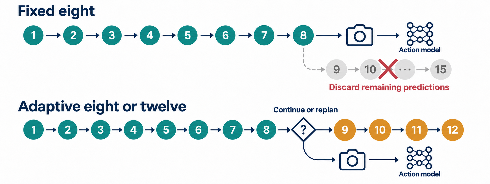
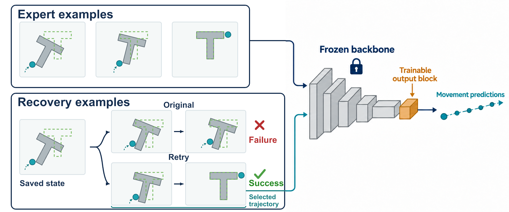

# Effective Prediction Utilization

**Adaptive Execution and Self-Imitation-Based Fine-Tuning for Robotic Pushing**

An ECE 730 course project on computation and AI for cyber-physical systems.

**Status: Work in progress.**

This project explores how to make more effective use of a pretrained robot model's predictions. The goal is to improve pushing success while reducing model predictions and runtime through two complementary methods: adaptive action execution and learning from successful self-generated trajectories.

## Task and feedback loop

In **PushT**, a simulated pusher moves a T-shaped block onto a target. A pretrained **Diffusion Policy** predicts movement sequences from camera images and the pusher's position. The simulator applies the movements and returns updated observations.

The software chooses actions using feedback from the simulated physical system. The adaptive controller also monitors camera feedback between new policy predictions, forming a cyber-physical control loop.

## Methods

### Adaptive action execution

The original baseline executes eight predicted movements before requesting a new prediction. Our lightweight controller decides whether to replan at that point or continue using up to four additional movements from the existing prediction.

It considers camera-estimated target alignment, recent decline and recovery, and the smoothness of the remaining movement path. Confirmed deterioration can trigger a bounded early interruption. A temporary alignment drop alone does not establish failure, because repositioning may be useful.

The model's prediction length and inference settings stay fixed. The controller changes how much of each prediction is executed.



### Self-imitation-based fine-tuning

The model's own successful movements provide additional training examples:

1. Select saved intermediate states from failed baseline attempts.
2. Sample multiple continuations using the original model.
3. Retain trajectories that eventually complete the task.
4. Mix these recovery trajectories with expert demonstrations and fine-tune only the final convolution block.

All other model parameters remain frozen. Training takes place before evaluation; the saved model then runs with fixed weights under either fixed-eight or adaptive execution.



## Evaluation and results

The four main metrics are:

- **Success rate:** more than 95% target coverage.
- **Average final alignment:** target coverage at the end of an attempt.
- **Average prediction calls:** new local policy inferences per attempt.
- **Average runtime:** attempt time including monitoring and control.

Failed attempts remain in the averages. Comparisons use matching initial scenes, repeated prediction samples and equal movement limits, with separate fine-tuning and evaluation scenes.

The completed four-configuration comparison uses **40 initial scenes with two prediction samples per scene**, giving 80 attempts per method. Three conditions reuse the original confirmation records; the fine-tuned fixed-eight condition adds 80 attempts on the same scenes:

| Method | Successful pushes | Mean final alignment | Mean predictions | Mean runtime |
|---|---:|---:|---:|---:|
| Original model with fixed-eight execution | 46/80 (57.5%) | 90.96% | 29.03 | 143.26 s |
| Original model with adaptive 8/12 execution | 48/80 (60.0%) | 91.59% | 25.34 | 135.95 s |
| Fine-tuned model with fixed-eight execution | 56/80 (70.0%) | 92.01% | 27.66 | 136.07 s |
| Fine-tuned model with adaptive 8/12 execution | **60/80 (75.0%)** | 91.88% | **22.51** | **120.92 s** |

### What the comparison shows

- **Fine-tuning:** observed success increased from **57.5% to 70.0%** with fixed-eight execution, and from **60.0% to 75.0%** with adaptive execution. These are the larger observed success gains in the component comparisons.
- **Adaptive execution:** average prediction calls fell by **12.70%** with the original model and **18.62%** with the fine-tuned model, compared with fixed-eight execution using the same respective weights. Prediction efficiency is its clearest additional benefit.
- **Combined method:** compared with the original baseline, success increased by **17.5 percentage points**, prediction calls fell by **22.44%**, and recorded average runtime fell by **15.60%**. It achieved the highest observed success count and lowest prediction/runtime averages among the four configurations.

The additional four successes from adaptive execution after fine-tuning remain uncertain, as does the fixed-eight fine-tuning success gain. Fine-tuning alone has slightly higher average final alignment than the combined method, but alignment differences are also uncertain. Some previously successful attempts still fail, so the results do not establish an improvement for every scene.

These results concern one trained checkpoint in clean two-dimensional simulation. Runtime spans collection sessions and is descriptive. Simulation pauses during inference, so these measurements do not demonstrate real-time or physical-robot performance. See the [four-configuration report](reports/2026-11-03-robotics-four-configuration-ablation.md) and the preserved [original confirmation](reports/2026-10-17-robotics-recovery-confirmation.md) for uncertainty, failure cases and reproduction details.

## Getting started

The workflow is verified on **Python 3.11.9**, an **NVIDIA GTX 1650 with 4 GB VRAM**, and **16 GB RAM**. The supplied inference runner requires CUDA. Dependencies are pinned in [requirements-robotics.txt](requirements-robotics.txt).

From PowerShell:

```powershell
git clone https://github.com/QihangFeng/efficient-robotic-pushing-with-diffusion-policy.git
cd efficient-robotic-pushing-with-diffusion-policy
py -3.11 -m venv .venv-robotics
.\.venv-robotics\Scripts\python.exe -m pip install -r requirements-robotics.txt
```

Run a baseline check with one initial scene:

```powershell
$env:HF_HUB_DISABLE_XET = "1"
$env:HF_HOME = Join-Path (Get-Location) "data\raw\huggingface"
.\.venv-robotics\Scripts\python.exe experiments\robotics_feasibility.py `
  --download --seeds 0 --output results\robotics-feasibility-repeat\summary.json
```

The first run downloads the pinned public checkpoint, approximately 1 GB, into `data/raw/robotics/diffusion_pusht/`. Use a new output path for subsequent runs to preserve previous results.

Prepared training data and fine-tuned weights stay local and are Git-ignored. Full preparation, training and evaluation workflows are documented in the [training report](reports/2026-10-16-robotics-recovery-pilot.md), [confirmation report](reports/2026-10-17-robotics-recovery-confirmation.md) and [ablation report](reports/2026-11-03-robotics-four-configuration-ablation.md).

## Repository structure

| Location | Contents |
|---|---|
| [experiments/](experiments/) | Controller, visual monitoring, data preparation, training and evaluation |
| [tests/](tests/) | Automated implementation and evidence checks |
| [reports/](reports/) | Method details, failure analysis and reproduction instructions |
| [results/](results/README.md) | Saved protocols, summaries and shareable experiment evidence |
| [course-deliverables/](course-deliverables/) | Proposal, slides and presentation script |

The main implementation entry points are [adaptive execution](experiments/robotics_adaptive_length.py), [visual monitoring](experiments/robotics_visual_monitor.py), [fine-tuning](experiments/robotics_recovery_training.py) and [evaluation](experiments/robotics_recovery_evaluation.py).

## Project documents

- [Project proposal](course-deliverables/project-proposal.pdf)
- [Proposal presentation](course-deliverables/proposal-presentation.pdf)
- [Presentation speaking script](course-deliverables/proposal_script.pdf)
- [Installation and hardware feasibility](reports/2026-10-10-robotics-laptop-feasibility.md)

The proposal and slides present the research plan; completed experimental evidence is documented in the reports.

## References and reused components

The pretrained policy, expert demonstrations and simulator are reused infrastructure. This project's focus is the execution controller, limited fine-tuning recipe and their evaluation.

- [Chi et al. Diffusion Policy: Visuomotor Policy Learning via Action Diffusion](https://arxiv.org/abs/2303.04137), RSS 2023.
- [Gym-PushT](https://github.com/huggingface/gym-pusht), the simulation environment.
- [LeRobot pretrained Diffusion Policy](https://huggingface.co/lerobot/diffusion_pusht) and [PushT demonstrations](https://huggingface.co/datasets/lerobot/pusht).
- [Jin et al. SIME: Enhancing Policy Self-Improvement with Modal-level Exploration](https://arxiv.org/abs/2505.01396), related work on policy self-improvement.
