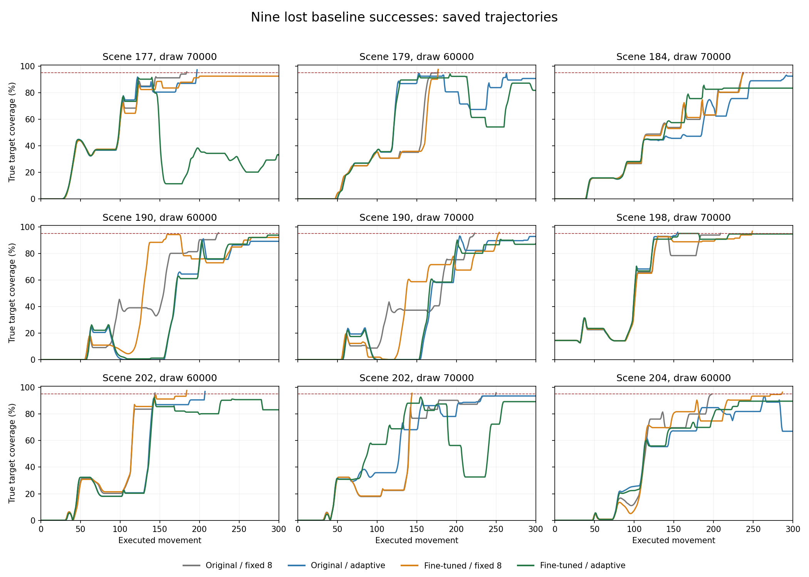

# Investigating the nine lost original-baseline successes

**The saved evidence does not support treating all nine losses as catastrophic forgetting or as one faulty interruption rule.** Seven of the nine attempts succeed with the same fine-tuned model under fixed-eight execution. The combined method's losses include destructive fresh predictions and final positioning stalls. This review identifies a bounded preservation experiment to discuss; it does not establish a recovery fix.

The combined method still gains 23 successes and loses nine against original fixed eight, giving 60/80 versus 46/80. Those nine scene/prediction-draw pairs cover **seven distinct starting scenes**. Preserving the gains matters as much as recovering selected losses.

## Scope and checks

This is CPU-only analysis of the existing four-configuration comparison on scenes 170–209, draw offsets 60000/70000. It reads all **320 attempts and 70,797 recorded movements**, rather than inspecting failures alone. No policy, training code or simulator is imported by the review or auditor. No model prediction, training update, physics replay, camera fitting, new pushing attempt or controller change occurred.

The [review](../results/robotics-baseline-loss-review/summary.json) binds 724 source/evidence files and verifies sidecars, compressed trace hashes, model identities, H16 generation, prediction accounting, first-success termination and common starting states. Existing frozen audits supply the earlier controller/queue provenance; this review does not claim to repeat neural inference or physics. The [separate arithmetic audit](../results/robotics-baseline-loss-review/artifact-audit.json) checks the component outcomes, peaks, stationary tails, matched-prefix indices and all comparison-group decline counts directly from raw JSON and traces.

Dynamic simulator geometry and true coverage are **offline diagnostics only**. Recorded camera estimates are identified separately. The unchanged runtime controller still uses its existing visual/path inputs. The designated milestone remains `0f40449`.

## 1. Separating weight changes from execution changes

Original fixed eight succeeds and fine-tuned/adaptive fails in every row below. The other two configurations separate different observed outcome patterns; they do not, by themselves, establish a causal mechanism.

| Original/adaptive succeeds? | Fine-tuned/fixed-eight succeeds? | Lost attempts | Interpretation to investigate |
|---|---|---:|---|
| No | Yes | 5 | The adaptive execution setting is associated with failure under either checkpoint. |
| Yes | Yes | 2 | Each component separately succeeds; their combination fails. |
| Yes | No | 1 | The fine-tuned checkpoint fails under either execution setting. |
| No | No | 1 | Both separate changes fail; original fixed eight alone succeeds. |

Thus **seven of nine** losses have a successful fine-tuned/fixed-eight control, while two also fail with fine-tuning alone. Calling all nine losses forgetting would overlook the execution interaction. Returning to fixed eight everywhere would also discard gains: over all eighty attempts, fine-tuned/fixed-eight succeeds 56 times versus 60 for the combined method and uses more predictions.

## 2. What happens in each saved combined attempt?

All nine combined attempts time out at 300 movements without ever crossing 95% true coverage. Values below are rounded for display; success uses the unrounded, strictly-greater-than-95% criterion.

| Scene / draw | Original/adaptive | Fine-tuned/fixed eight | Combined peak coverage / movement | Combined final coverage | Interruptions |
|---|---|---|---:|---:|---:|
| 177 / 70000 | Success | Fail | 91.56% / 140 | 32.90% | 1 |
| 179 / 60000 | Fail | Success | 94.23% / 192 | 81.78% | 1 |
| 184 / 70000 | Fail | Success | 85.62% / 188 | 83.45% | 0 |
| 190 / 60000 | Fail | Fail | 93.73% / 287 | 93.73% | 1 |
| 190 / 70000 | Fail | Success | 90.53% / 256 | 87.29% | 2 |
| 198 / 70000 | Success | Success | 94.97% / 157 | 94.58% | 0 |
| 202 / 60000 | Success | Success | 92.53% / 143 | 83.18% | 0 |
| 202 / 70000 | Fail | Success | 92.80% / 155 | 89.30% | 2 |
| 204 / 60000 | Fail | Success | 89.65% / 233 | 89.65% | 0 |



Curves end when the recorded attempt ends. The red dashed line marks 95%; the plot shows simulator coverage, not a runtime controller signal. Different trajectories after divergence are not matched-state alternatives.

### The first timing difference is not a failure explanation

For each lost pair, the two fine-tuned configurations execute exactly matching actions and physical/image states through **movements 1–8**. After movement 8, adaptive execution retains the existing plan; fixed eight predicts again before movement **9**. The adaptive run executes cached movements **9–12**. Its true coverage is unchanged during those four movements in all nine cases.

Movement 9 is a common timing difference: it occurs in **74 of all 80 pairs**, including successes. Five pairs first differ at movement 17 and one at movement 33. A shared early divergence is therefore not a usable failure label. Unchanged early coverage also does not prove the suffix harmless: object orientation, approach direction and later visited states can matter.

### Fresh predictions can worsen alignment

- **177 / 70000:** an interruption occurs after movement 144. The fresh prediction beginning before **145** lowers true coverage from **79.72% after 144 to 28.71% after 152**. This establishes a destructive recorded prefix, not that continuing the discarded plan or substituting the original policy would have succeeded.
- **179 / 60000:** after ordinary trimming at 208, the fresh prediction executes **209–216** and lowers coverage from **92.31% to 76.45%**. Interruption after 216 does not ensure recovery.
- **202 / 70000:** the fresh prediction beginning before **185** lowers coverage from **87.55% after 184 to 60.39% after 190**, where it is interrupted.

Simply asking the same model for another prediction is not an established recovery mechanism.

### Several attempts stall despite repeated predictions

| Scene / draw | Stationary block after movement | Remaining movements | Further predictions | Final coverage |
|---|---:|---:|---:|---:|
| 184 / 70000 | 214 | 86 | 10 | 83.45% |
| 198 / 70000 | 221 | 79 | 9 | 94.58% |
| 204 / 60000 | 233 | 67 | 8 | 89.65% |

Stationarity uses the earlier review's `1e-9` tolerance for block-origin translation and wrapped rotation per movement. The pusher continues moving. In the scene-198 example it travels about **187.98 simulator coordinate units** during the stationary tail. These observations concern block motion, not measured contact forces.

The near-threshold scene 198 also illustrates measurement limits: after movement **180**, camera-estimated coverage is **95.16%**, while simulator coverage is **94.97%**. Camera-estimated completion cannot replace the fixed scoring criterion.

## 3. Successful controls rule out simple decline labels

The three-percentage-point screen below is inherited from the earlier retrospective decision review, not selected to optimize these outcomes. A fresh-prefix window contains up to the first eight executed movements of one prediction, ending sooner if interrupted or terminated. An extension window contains up to its four cached extra movements.

| Combined-method outcome versus original fixed eight | Attempts | Extensions with >3 pp drawdown / all extensions | Attempts with a fresh-prefix >3 pp drawdown |
|---|---:|---:|---:|
| Both succeed | 37 | 6 / 253 | 28 / 37 |
| New success | 23 | 1 / 181 | 18 / 23 |
| Lost success | 9 | 0 / 98 | 9 / 9 |
| Both fail | 11 | 2 / 107 | 11 / 11 |

None of the 98 extensions in the nine losses causes an immediate >3 pp overlap drawdown. The largest recorded extension-window drawdown in these losses is **2.52 pp**. Earlier extensions may still affect later states; these data do not establish their causal benefit or harm.

All nine losses contain a >3 pp fresh-prefix drawdown, but so do **46 of the 60 successes**. Four losses have no interruption at all. These findings do not justify reopening the rejected warning/weighted filters, treating every decline as failure or adding an oracle success/failure gate.

## 4. A concrete preservation experiment to discuss

The literature distinguishes improving average performance from preserving previously correct behavior. [Positive-Congruent Training (CVPR 2021)](https://arxiv.org/abs/2011.09161) gives greater preservation weight to examples handled correctly by the old classifier. Its classification method is not a ready-made trajectory controller. [Learning without Forgetting](https://arxiv.org/abs/1606.09282) preserves old model responses during adaptation. [FDPP (ICRA 2025)](https://arxiv.org/html/2501.08259v1) tests diffusion-policy fine-tuning on PushT and uses a distribution-preservation penalty; its preference-based RL pipeline differs from our supervised update.

**The smallest training change worth discussing is baseline-success rehearsal:** include native, successful original-policy trajectories alongside the existing expert/recovery data. This is a proposed adaptation of the preservation idea, not a validated mitigation or a reproduction of PCT/FDPP.

We already have **20 ordinary successful baseline trajectories on discovery scenes 0–29**, prepared as diagnostic controls. They supply **2,686 complete native H16 windows** and were **not used in the current training**. Their arrays and source metadata are available; the new audit verifies their stored array hashes. Any reuse requires a new dataset manifest, leaving the diagnostic manifest intact.

One bounded candidate would:

1. Start from the same original checkpoint and update only the same final convolution block for 600 updates, retaining the learning rate, H16 labels, normalization and 100-step inference.
2. Keep four accumulated samples per update. Replace one of the two expert samples with a successful-baseline sample: **one expert + one baseline-success + two recovery**, versus the original **two expert + two recovery**. This preserves the recovery sample count and total denoiser training-call budget.
3. Split the twenty baseline-success scenes into sixteen training scenes and four validation scenes before training. Preserve the existing whole-scene recovery split. Exclude all forty evaluation scenes, their trajectories and the nine inspected losses from training/selection data.
4. Leave the milestone controller unchanged. There is no additional model or prediction call during deployment. A retention dataset may improve predicted movements; it is not guaranteed to resolve the seven execution-associated losses.
5. First compare the candidate, current combined model and original fixed-eight policy on a fixed development screen. Four held-out baseline-success scenes plus the three existing recovery-validation scenes, with two new prediction draws, would require **42 development attempts**. Historical per-attempt rates suggest roughly **90 minutes plus loading/checks**, not a measured runtime for the proposed model. Freeze the exact split, draws, checkpoint and stopping rule before running it.

The development screen should report gains and losses relative to original fixed eight, overall success, coverage, predictions and runtime, including failures. A candidate should advance only if it improves the retention trade-off without sacrificing the existing recovery behavior. Confirming generalization would then require a separately agreed, untouched evaluation cohort. The inspected scenes 170–209 cannot become fresh evaluation evidence for this redesign.

The isolated [retention runner](../experiments/robotics_retention_pilot.py) implements this prescribed candidate. All **16 CPU runner tests pass**, including exact resumption on a tiny test model, candidate checkpoint identity, protected outputs and scene-cluster statistics. Its [execution protocol](../results/robotics-retention-pilot/protocol.json) freezes all 600 training updates and the 42 development attempts. The original two recovery samples and first expert sample match the previous training schedule at every update; only the second expert slot changes, using a separate baseline-sampling RNG. No recovery benefit is established until the model run and complete comparison finish.

The explicit runner stages are `prepare`, `verify`, `train` and `evaluate`. Preparation and verification do not load the pretrained robot policy. Real training and pushing occur only in their named stages. More elaborate teacher-output anchoring remains a separate future option if rehearsal is inadequate; it is not part of this pilot.

### Prepared data and proposed schedule

The [separate data supplement](../results/robotics-retention-preflight/baseline-supplement.json) references the existing arrays without changing their original diagnostic metadata. All **3,006 RGB frames**, own pusher positions and **2,986 executed commands** match the twenty saved successful source traces. The supplement contains 2,686 complete H16 windows with two observations per sample and no padding. No image was re-rendered or re-fitted.

The whole-scene baseline split is selected by SHA-256 order with fixed key `20261107/baseline-retention`, before candidate outcomes:

- Baseline training scenes: **0, 8, 12, 13, 14, 17, 19, 20, 21, 22, 24, 25, 26, 27, 28, 29**.
- Baseline validation scenes: **1, 5, 10, 23**.
- Proposed development scenes: **1, 5, 10, 15, 16, 18, 23**, combining baseline holdouts with existing recovery validation scenes.
- Proposed prediction offsets: **91000/92000**. The three methods rotate within each scene/draw pair, giving the [42-attempt schedule](../results/robotics-retention-preflight/plan.json).

These are development scenes, not a new held-out generalization cohort. The prepared supplement excludes scenes 170–209. The original expert/recovery dataset, its splits, model checkpoints and previous evaluations remain unchanged. The plan is a reviewable proposal, not approval or evidence of successful training.

All ten preflight CPU tests and the [complete array/trace check](../results/robotics-retention-preflight/data-audit.json) pass. Repeating preparation reproduces identical JSON. The preflight has no training/evaluation command and imports no policy, optimizer or simulator. Run it with:

```powershell
.\.venv-robotics\Scripts\python.exe experiments\robotics_retention_preflight.py
.\.venv-robotics\Scripts\python.exe -m unittest discover -s tests -p test_robotics_retention_preflight.py
```

## Reproduction and validation

From the project root, diagnostics and the independent audit use the existing robotics environment and standard-library code:

```powershell
.\.venv-robotics\Scripts\python.exe experiments\robotics_baseline_loss_review.py
.\.venv-robotics\Scripts\python.exe experiments\robotics_baseline_loss_review_audit.py
.\.venv-robotics\Scripts\python.exe -m unittest discover -s tests -p test_robotics_baseline_loss_review.py
```

The **15 CPU tests pass**. They cover within-window drawdown versus net progress, early-ended cached suffixes, exact movement indices, RGB/action prefix mismatches, protected evidence, all nine losses, successful controls and component outcome counts. The independent audit passes and verifies **724 source/evidence bindings**. Existing results and frozen sources remain unchanged.

The optional coverage plot uses `--plot` with Matplotlib available. It was rendered with isolated scratch plotting packages (Matplotlib 3.9.2, NumPy 1.26.4); no plotting package was installed into `.venv-robotics`. Numerical review and verification require no new plotting dependency.

This is retrospective diagnostic evidence. It does not show that copying a successful baseline trajectory from another state will work, that all negative flips can be removed, or that a proposed preservation recipe improves unseen scenes. The [earlier loss review](2026-10-13-robotics-lost-success-review.md) and its stopped controller directions remain preserved.
